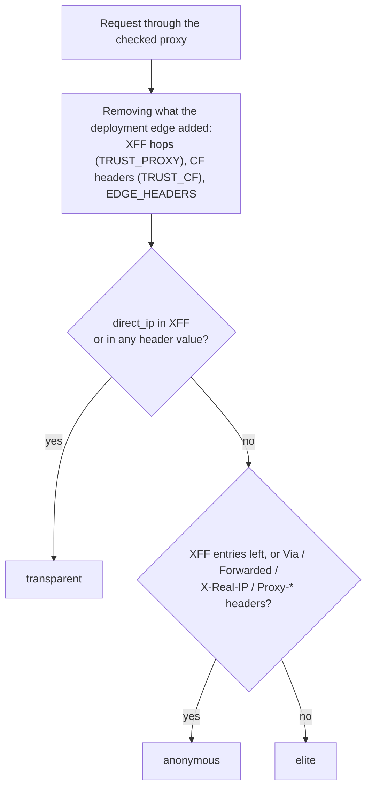

# ProxPulse Judge

**English** | [Русский](README.ru.md)

[](https://github.com/nechel12/proxpulse-judge/actions/workflows/docker.yml)
[](https://github.com/nechel12/proxpulse-judge/releases)
[](LICENSE)
[](https://github.com/nechel12/proxpulse-judge/pkgs/container/proxpulse-judge)
[](Cargo.toml)
[](https://deps.rs/repo/github/nechel12/proxpulse-judge)
[](https://github.com/nechel12/proxpulse-judge/security/code-scanning)
[](SECURITY.md)
[](https://github.com/nechel12/proxpulse-judge/commits/main)
[](CONTRIBUTING.md)

Self-hosted backend for proxy checking. A single `GET /judge` request returns
the proxy exit IP, its anonymity level, geo and ASN from **local** `.mmdb`
files, the IP type, and a hash of fixed content for tamper checks.

Stack: **Rust + axum + tokio**, databases in RAM, lookup cache. No third-party
HTTP APIs in the request path; a configurable per-client rate limiter
(`RATE_LIMIT_PER_MINUTE`, 6000/min by default). The service is a single binary
on `debian:trixie-slim`; the default image also includes `curl` and `gzip` for
the optional database download fallback, the Render image does not.

> Status: pre-1.0. The documented HTTP endpoints are intended to be stable,
> but behavior may change in minor releases.

## Contents

- [Quickstart](#quickstart) · [Prebuilt image and binaries](#prebuilt-image-and-binaries)
- Deployment: [A — Caddy](#variant-a--caddy-reverse-proxy) (or [nginx](#nginx-instead-of-caddy)) ·
  [B — Cloudflare Tunnel](#variant-b--cloudflare-tunnel-no-caddy-no-open-ports) ·
  [C — Render](#variant-c--render-free-hosting-no-vps)
- [Endpoints](#endpoints) · [How verdicts are decided](#how-verdicts-are-decided) ·
  [Using it from the checker](#using-it-from-the-checker)
- [Public instances](#public-instances) · [Databases](#databases)
- [Configuration](#configuration) · [Monitoring](#monitoring) ·
  [Troubleshooting](#troubleshooting)
- [Limitations](#limitations) · [Security](#security) ·
  [Development](#development)

## Quickstart

Requires [Docker](https://docs.docker.com/get-docker/) with Compose, plus
`bash`, `curl`, and `gzip` for the database download script. For Docker-free
development, [Rust](https://rustup.rs/) 1.88 or newer is required.

```sh
git clone https://github.com/nechel12/proxpulse-judge.git
cd proxpulse-judge
bash scripts/download-dbip.sh   # downloads City + ASN, no keys needed
cp .env.example .env
docker compose up -d --build

curl http://127.0.0.1:8000/judge
```

### Prebuilt image and binaries

CI publishes a multi-arch (`linux/amd64`, `linux/arm64`) image with embedded
DB-IP Lite databases to GHCR:

```sh
docker pull ghcr.io/nechel12/proxpulse-judge:latest
```

Monthly scheduled builds refresh the databases and update `:latest` and
`:YYYYMM`; signed `vX.Y.Z` release tags additionally publish `:vX.Y.Z`, which
is never overwritten. Every image passes a smoke test with the baked databases
and a Trivy scan before it is pushed, and carries a signed build provenance
attestation:

```sh
gh attestation verify oci://ghcr.io/nechel12/proxpulse-judge:latest --owner nechel12
```

These images are intended for stateless hosts such as Render and do not
contain MaxMind data. For a VPS with local MaxMind/DB-IP files, the default
`Dockerfile` target is built and `./geo` is mounted as described below.

Each [GitHub release](https://github.com/nechel12/proxpulse-judge/releases)
also ships static Linux binaries (`x86_64`, `aarch64`) with `SHA256SUMS` and
attestations.

> [!IMPORTANT]
> The image defaults to `TRUST_PROXY=0` and `TRUST_CF=0`: the client IP is the
> socket address. Both values must match the deployment topology (`render.yaml`
> already sets them to `1` for Render). `TRUST_CF=1` is safe only when every
> request reaches the container through Cloudflare: otherwise any client can
> spoof its IP, geo and rate-limit key with a `CF-Connecting-IP` header.

## Variant A — Caddy (reverse proxy)

A **dedicated domain** is required (no HTTPS certificate is issued without
one). The subdomain can be anything, e.g. `check.yourdomain.com`: an
**A-record** for the subdomain is created in the registrar's DNS panel,
pointing at the server IP, and ports **80 and 443** must face the internet.
Example in `Caddyfile.example`:

```caddy
check.yourdomain.com {
    reverse_proxy 127.0.0.1:8000 {
        trusted_proxies 0.0.0.0/0 ::/0
        header_up -CF-Connecting-IP
        header_up -True-Client-IP
    }
}
```

Caddy issues a Let's Encrypt certificate automatically on first request.
Verification:

```sh
curl https://check.yourdomain.com/healthz
```

`Caddyfile.example` enables `trusted_proxies`: since Caddy 2.5 the incoming
`X-Forwarded-For` from the checked proxy is dropped by default, so the judge
would not see a real-IP leak passed via XFF. Trusting XFF from all clients is
safe only because the judge listens on `127.0.0.1` and is reachable solely
through Caddy. `TRUST_CF=0` (the default) is required for this variant: there
is no Cloudflare here, and CF headers are trivially forgeable.

If Cloudflare sits **in front of** Caddy, the CF headers are not stripped:
`trusted_proxies` is set to Cloudflare's ranges instead of `0.0.0.0/0`, ports
80/443 are restricted to Cloudflare IPs (or Authenticated Origin Pulls is
used, since `trusted_proxies` only governs `X-Forwarded-*`, not
`CF-Connecting-IP`), and both `TRUST_CF=1` and `TRUST_PROXY=1` are required.

### nginx instead of Caddy

[`nginx.conf.example`](nginx.conf.example) is the equivalent server block. The
important parts:

```nginx
proxy_set_header X-Forwarded-For $proxy_add_x_forwarded_for;
proxy_set_header CF-Connecting-IP "";
proxy_set_header True-Client-IP "";
```

nginx appends the connecting address to the proxy's `X-Forwarded-For`, so
`TRUST_PROXY=1` works as with Caddy. `X-Real-IP`, `Via`, and `Forwarded` are
**not** added there (many nginx templates do): the judge treats them as proxy
telltales, and every check would come out `anonymous`. If a configuration
requires them, they are listed in `EDGE_HEADERS` (e.g.
`EDGE_HEADERS=x-real-ip`) so they are not attributed to the checked proxy.

## Variant B — Cloudflare Tunnel (no Caddy, no open ports)

```sh
cloudflared tunnel --url http://127.0.0.1:8000
```

or no config-file commands at all — via the Cloudflare website:
**Zero Trust → Networks → Tunnels → Create a tunnel**; a tunnel name is
chosen, and the **Public Hostname** tab contains: subdomain `check`, the
domain (e.g. `check.yourdomain.com`), service
`http://proxpulse-judge:8000` (container on the shared network; details below) or
`http://127.0.0.1:8000` (cloudflared on the host). The token from the website
is passed into the connector container:

```sh
docker run -d --name cf-tunnel --restart unless-stopped \
  --network proxpulse-net \
  cloudflare/cloudflared:latest tunnel --no-autoupdate run --token <TOKEN>
```

or a named tunnel with DNS on `check.yourdomain.com` and ingress:

```yaml
tunnel: <id>
credentials-file: /root/.cloudflared/<id>.json
ingress:
  - hostname: check.yourdomain.com
    service: http://127.0.0.1:8000
  - service: http_status:404
```

> Important: if cloudflared runs **in docker**, `localhost` inside its
> container is itself, and the name `proxpulse-judge` is only visible on the
> shared network. So the tunnel container must sit on the same network as
> judge — the `proxpulse-net` network from `docker-compose.yml` is created
> automatically:
>
> ```sh
> docker network connect proxpulse-net cf-tunnel
> docker network inspect proxpulse-net --format '{{range .Containers}}{{.Name}} {{end}}'
> # both must be visible: proxpulse-judge and cf-tunnel
> ```
>
> with ingress/service pointing to `http://proxpulse-judge:8000`.
> cloudflared on the host itself simply goes to `http://127.0.0.1:8000`.

`TRUST_CF=1` and `TRUST_PROXY=1` are required explicitly in this variant;
`TRUST_CF` defaults to `0`, which is safe for Caddy/VPS. The service takes
the real IP from `CF-Connecting-IP` (set by Cloudflare itself, takes
priority over `X-Forwarded-For`). Known Cloudflare infrastructure headers are
excluded from anonymity detection, while unknown `cf-*` headers are still checked
for `direct_ip` leaks. Verification:

```sh
MYIP=$(curl -s https://api.ipify.org)
curl -s "https://check.yourdomain.com/judge?direct_ip=$MYIP" | head -c 300; echo
# expect "anonymity":"elite"
```

## Variant C — Render (free hosting, no VPS)

[](https://render.com/deploy?repo=https://github.com/nechel12/proxpulse-judge)

A ready image with embedded DB-IP Lite rebuilds itself every month
(`.github/workflows/docker.yml` → `ghcr.io/nechel12/proxpulse-judge:latest`),
no disk needed. The button creates the service from `render.yaml` with
a free `https://<name>.onrender.com` domain. The resulting URL is used in
the checker. No Cloudflare Tunnel is needed in this setup: Render
provides both TLS and the domain.

Free-plan notes:

- The service sleeps after 15 minutes without traffic; waking up takes
  about a minute. The first check after idle may partially fail on
  timeouts — repeating it is sufficient. A single service approximately
  matches the free 750 h/month allowance.
- The filesystem is ephemeral, but that is fine: the databases are
  baked into the image.
- `TRUST_PROXY=1` and `TRUST_CF=1` are required (Render traffic passes
  through Cloudflare; the real IP is taken from `CF-Connecting-IP`).
  `render.yaml` sets both; the image itself defaults to `0`, so a service
  created by hand needs both variables in the Render dashboard
  (Environment). The `PORT` variable is provided by Render and must not
  be overridden.
- The image carries DB-IP Lite only: the GeoLite2 EULA restricts public
  redistribution, so MaxMind data is not baked into the published image.
  MaxMind requires the VPS + volume variant above.

Database updates (the image rebuilds on the 3rd of every month):

1. **Fork + auto-hook.** A fork of the repository is created, workflows are
   enabled in the fork's Actions tab (disabled by default), a
   `RENDER_DEPLOY_HOOK` secret is added (Render dashboard → service →
   Settings → Deploy Hook), and the fork's `render.yaml` points at its own
   `ghcr.io/<owner>/proxpulse-judge:latest`. Fresh images are then published
   to the fork's GHCR and trigger redeploys automatically. Limitation: the
   schedule is disabled after 60 days without activity in the fork — the
   workflow is run manually from time to time (Run workflow).
2. **Manually.** Render dashboard → service → Manual Deploy →
   Deploy latest reference. Geo data changes slowly, so manual updates
   are usually sufficient.
3. **Own scheduler, no fork.** The service can track
   `ghcr.io/nechel12/proxpulse-judge:latest` directly while any external
   scheduler (own server, cron-job.org, etc.) calls the deploy hook monthly.

The image is compatible with other container hostings: `$PORT`
passthrough and `/healthz` as the health check are required.

## Endpoints

| Method | Path | Purpose |
|---|---|---|
| GET | `/` | service, version, repository, geo sources, licenses |
| GET | `/generate_204` | `204` empty — cheap liveness check |
| GET | `/ip` | `{"ip": "..."}` — exit IP |
| GET | `/headers` | `{"ip", "headers", "xff_chain"}` — header echo |
| GET | `/geo` | `{"ip", "geo", "source", "attribution"}` — country/city/ASN from local DBs |
| GET | `/type` | `{"ip", "ip_type", "signals"}` — IP type with reasoning |
| GET | `/content` | fixed bytes — integrity reference |
| GET | `/judge?direct_ip=...` | everything at once + `anonymity`, `content_sha256` |
| GET | `/healthz` | `{"ok": true}` — liveness probe |
| GET | `/readyz` | `{"ok", "geo_ready", "geo_sources"}` — readiness |
| GET | `/metrics` | Prometheus text counters (optionally behind `METRICS_TOKEN`) |

`/headers` and `/judge` echo the headers as the checked proxy sent them: the
`X-Forwarded-For` hops appended by the deployment's reverse proxy and
`EDGE_HEADERS` are removed, so only what came from the proxy side is shown.

Example `/judge` response through an anonymous proxy, with DB-IP databases:

```json
{
  "ip": "203.0.113.7",
  "anonymity": "anonymous",
  "xff_chain": [],
  "headers": {
    "host": "check.yourdomain.com",
    "user-agent": "curl/8.10.1",
    "via": "1.1 squid",
    "x-forwarded-proto": "https"
  },
  "geo": {
    "ip": "203.0.113.7",
    "country": "Germany",
    "country_code": "DE",
    "city": "Frankfurt am Main",
    "latitude": 50.1155,
    "longitude": 8.6842,
    "asn": 24940,
    "aso": "Hetzner Online GmbH"
  },
  "geo_source": {"asn": "dbip-asn-lite.mmdb", "city": "dbip-city-lite.mmdb"},
  "attribution": ["IP Geolocation by DB-IP (https://db-ip.com)"],
  "ip_type": "datacenter",
  "type_signals": {
    "org": "Hetzner Online GmbH",
    "rdns": null,
    "hosting_kw": [],
    "hosting_vendor": ["hetzner"],
    "mobile_kw": [],
    "residential_kw": [],
    "business_kw": []
  },
  "content_version": 1,
  "content_sha256": "1a0525d8797ca470e7b4a7c47622a89b011760f9db2d587ce7a5e06e99c1bcb9"
}
```

## How verdicts are decided

| `anonymity` | Meaning |
|---|---|
| `transparent` | The checker's `direct_ip` appears in the forwarded chain or in any other header value (in any IPv4/IPv6 spelling): the proxy leaks the real client IP. |
| `anonymous` | No leak, but the proxy reveals itself: `X-Forwarded-For` entries (even `unknown`), or `Via`, `Forwarded`, `X-Real-IP`, `Proxy-*`, `X-Proxy*` headers. |
| `elite` | Neither: the request looks like a direct one. |



Without `direct_ip` a leak cannot be told apart from an ordinary forwarded
address, so the result is at most `anonymous`. `ip_type` is `mobile`,
`datacenter`, `business`, `residential`, or `unknown`, derived from the ASN
organization (and the PTR record when the organization is unknown);
`type_signals` lists the keywords that matched.

## Using it from the checker

1. Direct `GET /ip` request — the checker's own IP (`direct_ip`).
2. `GET /judge?direct_ip=<checker-ip>` through a proxy — the `anonymity` field:
   `elite` (leaks nothing), `anonymous` (proxy visible, IP hidden),
   `transparent` (real IP leaked).
3. Integrity: bytes from `GET /content` directly and through the proxy are
   compared (or `content_sha256` from `/judge`).
4. Geo and type are already inside `/judge`. There is no rDNS parameter:
   the server resolves PTR itself, only when the ASN org is unknown (otherwise
   it changes nothing), at most 16 resolutions in parallel, answers cached
   for an hour.
5. A liveness check is just `GET /generate_204` (empty 204, the cheapest request).

## Public instances

These are shared, best-effort instances without an availability guarantee.
For regular measurements, a self-hosted instance is required (variants A–C
above).

- **https://proxycheck.lmtunnel.com** — enabled in the checker by default.
  Configured with a 1000 requests per minute per client limit (429 +
  `Retry-After` on exceed; the table below lists the code default of 6000).
- **https://proxpulse-judge.onrender.com** — free Render hosting, DB-IP Lite
  databases, image refreshed monthly. The free plan sleeps after 15 minutes
  without traffic (waking up takes about a minute) and is limited to roughly
  750 hours per month, so it may be unavailable near the end of the month
  until the quota resets.

Load is expected to remain reasonable: reverse-DNS is done by the server itself
and only for unknown ASN orgs; no client-side requests are needed.

## Databases

The `./geo` directory is mounted into the container read-only. The service
finds files by itself:

- `GeoLite2-City.mmdb` or `dbip-city-lite.mmdb`
- `GeoLite2-ASN.mmdb` or `dbip-asn-lite.mmdb`
- `GeoLite2-Country.mmdb` or `dbip-country-lite.mmdb` — fallback if there is no City

Without files, geo fields come back empty (`"error": "no db"`); the type
is usually `unknown` (rDNS may still provide a hint); everything else
works.

### Database licenses (important)

The files themselves are not in the repository — they are downloaded
separately, and each database has its own terms:

- **DB-IP Lite** — [CC BY 4.0](https://creativecommons.org/licenses/by/4.0/).
  Attribution is required — an `IP Geolocation by DB-IP` link
  to <https://db-ip.com> wherever results from the database are shown.
  Updated **monthly**. Details: <https://db-ip.com/db/lite.php>
- **MaxMind GeoLite2** (City / ASN / Country) — needs a free account
  and key. Usage is governed by the
  [GeoLite EULA](https://www.maxmind.com/en/geolite/eula) (incorporates aspects
  of [CC BY-SA 4.0](https://creativecommons.org/licenses/by-sa/4.0/)).
  Attribution is required: `This product includes GeoLite2 Data
  created by MaxMind, available from https://www.maxmind.com`.

### Do databases update themselves? No

`scripts/download-dbip.sh` (no keys) or `scripts/download-geolite2.sh`
(needs `MAXMIND_LICENSE_KEY` from a free account) are manual: after download,
files land in `./geo`, and a container **restart is required** (the geo cache
lives in memory, new files are not picked up without a restart). For
automation — monthly cron + restart:

```cron
0 4 3 * * cd /opt/proxpulse-judge && bash scripts/download-dbip.sh >/tmp/dbip.log 2>&1 && docker compose restart judge
```

`docker-compose` mounts `./geo` **read-only**, so the entrypoint cannot
write there: for compose, the databases are downloaded on the host
(`bash scripts/download-dbip.sh`), or an image with baked databases is used
(Render). The entrypoint fallback only works when `GEO_DIR` is writable
(e.g. `docker run` without a read-only mount); otherwise it logs a warning
and starts without geo. Custom files (MaxMind or DB-IP) take precedence —
the fallback only fires when no valid `.mmdb` is present.

## Maintenance: logs

The service logs to stdout. Docker's `json-file` driver stores them with no
size limit by default, so `docker-compose.yml` sets limits (`max-size: 10m`,
`max-file: 3` — up to ~30 MB per container). With a compose setup no further
configuration is needed. The compose service also runs with a read-only root
filesystem, no capabilities, `no-new-privileges`, and a 512 MB memory limit.

For running without Docker with logs in a file — example
`/etc/logrotate.d/proxpulse-judge`:

```
/opt/proxpulse-judge/*.log /var/log/proxpulse-judge/*.log {
    weekly
    rotate 4
    compress
    missingok
    notifempty
    copytruncate
}
```

## Configuration

| Variable | Default | Meaning |
|---|---|---|
| `PORT` | `8000` | HTTP port |
| `BIND_ADDR` | `0.0.0.0` | listen address; `::` also accepts IPv6 where the host allows dual-stack sockets |
| `GEO_DIR` | `/app/geo` | `.mmdb` directory |
| `TRUST_PROXY` | `0` | `1` — behind a reverse proxy (IP from the end of `X-Forwarded-For`), `0` — directly exposed (IP from socket, headers untrusted); `.env.example` explicitly sets `1` |
| `TRUST_CF` | `0` | `1` — trust `CF-Connecting-IP`; only behind Cloudflare/Tunnel and only with `TRUST_PROXY=1`. `0` — ignore (safe for Caddy/VPS) |
| `EDGE_HEADERS` | empty | comma-separated headers the deployment's reverse proxy adds (e.g. `x-real-ip,via`); they are neither analysed nor echoed. Only with `TRUST_PROXY=1`; `x-forwarded-for` is not allowed |
| `RDNS_TIMEOUT` | `1.5` | server-side rDNS timeout, seconds; clamped to 0–60, invalid values fall back to 1.5 |
| `RATE_LIMIT_PER_MINUTE` | `6000` | token-bucket burst and sustained requests per client per minute (an IPv4 address or an IPv6 `/64`), `0` — no limit |
| `METRICS_TOKEN` | empty | when set, `/metrics` requires `Authorization: Bearer <token>` |
| `RUST_LOG` | `info` | log level |

`TRUST_PROXY` and `TRUST_CF` accept `1`/`0`, `true`/`false`, `yes`/`no`,
`on`/`off`; any other value, an invalid `BIND_ADDR`, or a malformed
`EDGE_HEADERS` stops the service at startup instead of silently changing which
headers are trusted.

With `TRUST_PROXY=1`, the client IP is taken from the **last**
`X-Forwarded-For` entry. Caddy 2.5+ replaces the incoming XFF with the
immediate client address by default; `Caddyfile.example` enables
`trusted_proxies` to preserve the checked proxy's chain, so Caddy appends
the client address at the end. nginx (`proxy_add_x_forwarded_for`) and
Cloudflare append as well. Reverse-proxy headers such as
`X-Forwarded-Proto`/`Host` are excluded from anonymity detection; otherwise
everything behind a reverse proxy would look `anonymous`. With `TRUST_CF=1`,
`CF-Connecting-IP` takes priority.

## Monitoring

- `GET /healthz` — liveness.
- `GET /readyz` — readiness plus `geo_ready` and the loaded `geo_sources`.
- `GET /metrics` — Prometheus text counters (requests, 4xx/5xx, rate limits,
  rDNS, build info). On a public instance, `METRICS_TOKEN` is set (or the path
  is blocked at the reverse proxy).

Request headers must arrive within 10 seconds, at most 4096 connections are
open at once, and a request is capped at 20 seconds and 512 concurrent
requests. Monitoring endpoints are exempt from the rate and concurrency
limits; metrics are process-local and reset on restart.

## Troubleshooting

| Symptom | Cause and fix |
|---|---|
| Every check is `anonymous`, even an elite proxy | A reverse proxy on the deployment side adds `X-Real-IP`, `Via`, or `Forwarded` (typical for nginx). Such headers are removed from the proxy configuration or listed in `EDGE_HEADERS`. `GET /headers` directly shows what reaches the judge. |
| A direct check (no proxy) is `transparent`, and `/ip` shows `127.0.0.1` or `172.x` | The judge is behind a reverse proxy with `TRUST_PROXY=0`: `TRUST_PROXY=1` is required. |
| A proxy known to leak is reported `elite` behind Caddy | Caddy drops the incoming `X-Forwarded-For`: `trusted_proxies` is required, as in `Caddyfile.example`. |
| `/ip` shows a Cloudflare address (`172.64.x`, `162.158.x`, …) | Traffic comes through Cloudflare but `TRUST_CF=0`: `TRUST_CF=1` and `TRUST_PROXY=1` are required. |
| Geo fields are empty with `"error": "no db"`; `/readyz` has `"geo_ready": false` | No `.mmdb` in `./geo`. The fix is to run `bash scripts/download-dbip.sh` and restart the container. |
| The container exits with `invalid configuration` | A misspelled `TRUST_*` value, an invalid `BIND_ADDR`, or `x-forwarded-for` in `EDGE_HEADERS`; the log names the variable. |
| `/metrics` returns `401` | `METRICS_TOKEN` is set: the request must include `Authorization: Bearer <token>`. |
| Render: the first request after a pause times out | The free plan sleeps after 15 minutes; a retry after about a minute resolves it. |

## Limitations

- Anonymity and IP-type results are heuristics. A proxy can withhold or forge
  headers, and local data cannot prove residential-vs-business the way paid
  ASN databases can.
- TLS/JA3 is not inspected: TLS terminates at Caddy, Cloudflare, Render, or
  another reverse proxy.
- Geo accuracy depends on the local database and its update cadence.
- The public instances are shared and best-effort; a self-hosted instance is
  required for reliable measurements.

## Security

Vulnerability reporting is described in [SECURITY.md](SECURITY.md).

The judge is a diagnostic tool, not a security boundary. It does not
authenticate clients and cannot force a proxy to reveal headers; verdicts are
best-effort. It should run behind a TLS-terminating reverse proxy, with the HTTP
port bound to loopback, a rate limit configured, and `TRUST_PROXY`/`TRUST_CF`
matching the actual topology. A misconfigured trusted header lets clients spoof
the reported IP/geo and the rate-limit key.

## Development

```sh
cargo test        # logic, geo (real .mmdb fixtures), API, server limits
PORT=8000 GEO_DIR=./geo TRUST_PROXY=0 cargo run

scripts/smoke.sh http://127.0.0.1:8000
scripts/load.sh http://127.0.0.1:8000 300 32
```

Structure: `src/main.rs` (startup, healthcheck), `src/config.rs` (environment),
`src/server.rs` (connections, timeouts, graceful shutdown), `src/app.rs`
(routes, middleware, handlers), `src/ratelimit.rs`, `src/metrics.rs`,
`src/geo.rs` (`.mmdb` pool), `src/logic.rs` (anonymity, IP type, fixed
content). The minimum supported Rust version is 1.88; CI checks it.

## Related projects

- [proxpulse](https://github.com/nechel12/proxpulse) — desktop proxy
  checker (Tauri 2) that uses the judge as its check backend; the public
  instance above is embedded in it by default.

## Contributing

Bug reports and pull requests are welcome. The development workflow is
described in [CONTRIBUTING.md](CONTRIBUTING.md). Participation implies
agreement with the [Code of Conduct](CODE_OF_CONDUCT.md). Before a change is
sent, the checks `cargo fmt --check`,
`cargo clippy --all-targets -- -D warnings`, and `cargo test` must pass.
Security issues should be reported through [SECURITY.md](SECURITY.md), not a
public issue. Release notes live in [CHANGELOG.md](CHANGELOG.md); maintainers
can follow [RELEASING.md](RELEASING.md).

## License

The code is licensed under Apache-2.0; the license text is in
[LICENSE](LICENSE). Geolocation databases are not part of the code license:
DB-IP Lite is CC BY 4.0, and MaxMind GeoLite2 is governed by the GeoLite2 EULA.
Database files are downloaded separately or baked into the DB-IP image with
attribution.

---

## Support the project

ProxPulse Judge is free and open source. If it saves time, further development
can be supported here:

<p align="center">
  <a href="https://boosty.to/nechel12/donate">
    
  </a>
</p>

### Crypto

| Network | Address |
|:--------|:--------|
| **TRON** | `TMM2Cdm4tJx1nKRRq5RCBcdwfn9cHuJZy9` |
| **TON** | `UQBlVvOfTleWn4pkY384mYWiGyhdHBryoC_N1Si1OSWAxPKl` |
| **Bitcoin** | `bc1qagjtnutjya2rss3u3ls8ur7qk0u7zutc6t6fwc` |
| **BNB Smart Chain** | `0x423aF840f67355371bf32480744A84069dfab5ff` |

> [!WARNING]
> Only the asset matching the specified network may be sent. Transfers to
> another network cannot be recovered.
