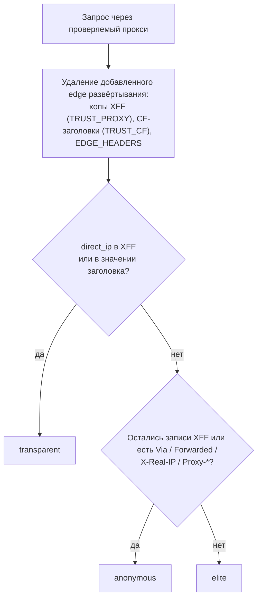

# ProxPulse Judge

[English](README.md) | **Русский**

[](https://github.com/nechel12/proxpulse-judge/actions/workflows/docker.yml)
[](https://github.com/nechel12/proxpulse-judge/releases)
[](LICENSE)
[](https://github.com/nechel12/proxpulse-judge/pkgs/container/proxpulse-judge)
[](Cargo.toml)
[](https://deps.rs/repo/github/nechel12/proxpulse-judge)
[](https://github.com/nechel12/proxpulse-judge/security/code-scanning)
[](SECURITY.md)
[](https://github.com/nechel12/proxpulse-judge/commits/main)
[](CONTRIBUTING.md)

Self-hosted backend для проверки прокси. Один запрос `GET /judge` возвращает
IP выхода прокси, уровень анонимности, гео и ASN из **локальных** `.mmdb`,
тип IP и хэш фиксированного контента для проверки целостности.

Стек: **Rust + axum + tokio**, базы в ОЗУ, кэш лукапов. Без сторонних
HTTP API в обработке запросов; rate-limit на клиента настраивается
(`RATE_LIMIT_PER_MINUTE`, по умолчанию 6000/мин). Сервис — один бинарь на
`debian:trixie-slim`; в образ по умолчанию также входят `curl` и `gzip` для
опционального fallback-скачивания баз, в образ для Render — нет.

> Статус: pre-1.0. Документированные HTTP-эндпоинты считаются стабильными,
> но поведение может меняться в минорных релизах.

## Содержание

- [Быстрый старт](#быстрый-старт) · [Готовый образ и бинарники](#готовый-образ-и-бинарники)
- Развёртывание: [А — Caddy](#вариант-а--caddy-реверс-прокси) (или [nginx](#nginx-вместо-caddy)) ·
  [Б — Cloudflare Tunnel](#вариант-б--cloudflare-tunnel-без-caddy-и-открытых-портов) ·
  [В — Render](#вариант-в--render-бесплатный-хостинг-без-vps)
- [Эндпоинты](#эндпоинты) · [Как выносится вердикт](#как-выносится-вердикт) ·
  [Как пользоваться из чекера](#как-пользоваться-из-чекера)
- [Публичные инстансы](#публичные-инстансы) · [Базы](#базы)
- [Конфигурация](#конфигурация) · [Мониторинг](#мониторинг) ·
  [Частые проблемы](#частые-проблемы)
- [Ограничения](#ограничения) · [Безопасность](#безопасность) ·
  [Разработка](#разработка)

## Быстрый старт

Нужны [Docker](https://docs.docker.com/get-docker/) с Compose, а также
`bash`, `curl` и `gzip` для скрипта скачивания баз. Для разработки без
Docker — [Rust](https://rustup.rs/) 1.88 или новее.

```sh
git clone https://github.com/nechel12/proxpulse-judge.git
cd proxpulse-judge
bash scripts/download-dbip.sh   # качает City + ASN без ключей
cp .env.example .env
docker compose up -d --build

curl http://127.0.0.1:8000/judge
```

### Готовый образ и бинарники

CI публикует в GHCR мультиархитектурный образ (`linux/amd64`, `linux/arm64`)
со вшитыми базами DB-IP Lite:

```sh
docker pull ghcr.io/nechel12/proxpulse-judge:latest
```

Ежемесячные плановые сборки обновляют базы и теги `:latest` и `:YYYYMM`;
подписанный релизный тег `vX.Y.Z` дополнительно публикует `:vX.Y.Z`, который
никогда не перезаписывается. Каждый образ перед публикацией проходит
smoke-тест со вшитыми базами и скан Trivy и несёт подписанную attestation о
происхождении сборки:

```sh
gh attestation verify oci://ghcr.io/nechel12/proxpulse-judge:latest --owner nechel12
```

Образы рассчитаны на stateless-хостинг (Render и аналоги) и не содержат
данных MaxMind. Для VPS с локальными файлами MaxMind/DB-IP используется цель
`Dockerfile` по умолчанию и смонтированный каталог `./geo`, как описано ниже.

К каждому [релизу на GitHub](https://github.com/nechel12/proxpulse-judge/releases)
прикладываются статические Linux-бинарники (`x86_64`, `aarch64`) с
`SHA256SUMS` и attestation.

> [!IMPORTANT]
> По умолчанию в образе `TRUST_PROXY=0` и `TRUST_CF=0`: IP клиента берётся из
> сокета. Оба параметра задаются в соответствии с фактической топологией
> (`render.yaml` уже устанавливает `1` для Render). `TRUST_CF=1` безопасен
> только когда каждый запрос приходит в контейнер через Cloudflare: иначе
> любой клиент может подделать IP, гео и ключ rate-limit заголовком
> `CF-Connecting-IP`.

## Вариант А — Caddy (реверс-прокси)

Требуется **отдельный домен** (без него HTTPS-сертификат не выпускается).
Поддомен может быть любым, например `check.yourdomain.com`: в DNS-панели
регистратора создаётся **A-запись** поддомена на IP сервера, а порты
**80 и 443** должны быть доступны извне. Пример в `Caddyfile.example`:

```caddy
check.yourdomain.com {
    reverse_proxy 127.0.0.1:8000 {
        trusted_proxies 0.0.0.0/0 ::/0
        header_up -CF-Connecting-IP
        header_up -True-Client-IP
    }
}
```

Caddy сам выпустит сертификат Let's Encrypt при первом обращении.
Проверка:

```sh
curl https://check.yourdomain.com/healthz
```

`Caddyfile.example` включает `trusted_proxies`: с Caddy 2.5+ без этого
входящий `X-Forwarded-For` проверяемого прокси отбрасывается, и judge
не увидит утечку реального IP через XFF. Доверять XFF всем клиентам
можно только потому, что judge слушает `127.0.0.1` и доступен лишь
через Caddy. Для этого варианта `TRUST_CF` должен оставаться `0`
(дефолт): Cloudflare здесь нет, а CF-заголовки легко подделать.

Если Cloudflare стоит **перед** Caddy, CF-заголовки не удаляются:
`trusted_proxies` задаётся диапазонами Cloudflare вместо `0.0.0.0/0`, порты
80/443 ограничиваются IP-диапазонами Cloudflare (либо включается
Authenticated Origin Pulls, поскольку `trusted_proxies` контролирует только
`X-Forwarded-*`, но не `CF-Connecting-IP`); также требуются `TRUST_CF=1`
и `TRUST_PROXY=1`.

### nginx вместо Caddy

[`nginx.conf.example`](nginx.conf.example) — аналогичный server-блок. Главное
в нём:

```nginx
proxy_set_header X-Forwarded-For $proxy_add_x_forwarded_for;
proxy_set_header CF-Connecting-IP "";
proxy_set_header True-Client-IP "";
```

nginx дописывает адрес подключившегося к `X-Forwarded-For` прокси, поэтому
`TRUST_PROXY=1` работает так же, как с Caddy. Заголовки `X-Real-IP`, `Via`
и `Forwarded` в этой конфигурации **не добавляются** (во многих шаблонах
nginx они есть): judge считает их признаками прокси, и каждая проверка выйдет
`anonymous`. Если без них обойтись нельзя, они перечисляются в `EDGE_HEADERS`
(например, `EDGE_HEADERS=x-real-ip`), чтобы не приписываться проверяемому
прокси.

## Вариант Б — Cloudflare Tunnel (без Caddy и открытых портов)

```sh
cloudflared tunnel --url http://127.0.0.1:8000
```

или вообще без команд в конфигах — через сайт Cloudflare:
**Zero Trust → Networks → Tunnels → Create a tunnel**; в туннеле задаётся
имя, а на вкладке **Public Hostname** указываются: subdomain `check`,
домен (например, `check.yourdomain.com`),
service `http://proxpulse-judge:8000` (контейнер в общей сети; подробности ниже)
или `http://127.0.0.1:8000` (cloudflared на хосте). Токен из сайта
передаётся в контейнер коннектора:

```sh
docker run -d --name cf-tunnel --restart unless-stopped \
  --network proxpulse-net \
  cloudflare/cloudflared:latest tunnel --no-autoupdate run --token <TOKEN>
```

или именованный туннель с DNS на `check.yourdomain.com` и ingress:

```yaml
tunnel: <id>
credentials-file: /root/.cloudflared/<id>.json
ingress:
  - hostname: check.yourdomain.com
    service: http://127.0.0.1:8000
  - service: http_status:404
```

> Важно, если cloudflared крутится **в docker**: `localhost` внутри его
> контейнера — это он сам, а имя `proxpulse-judge` видно только в общей
> сети. Поэтому контейнер туннеля должен сидеть в одной сети с judge —
> сеть `proxpulse-net` из `docker-compose.yml` создаётся автоматически:
>
> ```sh
> docker network connect proxpulse-net cf-tunnel
> docker network inspect proxpulse-net --format '{{range .Containers}}{{.Name}} {{end}}'
> # должны быть видны оба: proxpulse-judge и cf-tunnel
> ```
>
> и в ingress/service тогда `http://proxpulse-judge:8000`.
> cloudflared на самом хосте ходит просто на `http://127.0.0.1:8000`.

В этом варианте нужно явно выставить `TRUST_CF=1` и оставить
`TRUST_PROXY=1`; `TRUST_CF` по умолчанию `0` — это безопасно для Caddy/VPS.
Сервис возьмёт реальный IP из `CF-Connecting-IP` (его ставит сам
Cloudflare, приоритет выше `X-Forwarded-For`). Известные инфраструктурные
заголовки Cloudflare исключаются из детекта анонимности, а неизвестные `cf-*`
по-прежнему проверяются на утечку `direct_ip`. Проверка:

```sh
MYIP=$(curl -s https://api.ipify.org)
curl -s "https://check.yourdomain.com/judge?direct_ip=$MYIP" | head -c 300; echo
# ждём "anonymity":"elite"
```

## Вариант В — Render (бесплатный хостинг, без VPS)

[](https://render.com/deploy?repo=https://github.com/nechel12/proxpulse-judge)

Готовый образ со вшитыми DB-IP Lite собирается сам каждый месяц
(`.github/workflows/docker.yml` → `ghcr.io/nechel12/proxpulse-judge:latest`),
диск не нужен. Кнопка создаёт сервис по `render.yaml` с бесплатным доменом
`https://<имя>.onrender.com`. Полученный URL указывается в чекере.
Cloudflare Tunnel в этом варианте не требуется: TLS и домен
предоставляет Render.

Особенности free-плана:

- Сервис засыпает после 15 минут без трафика, пробуждение занимает
  около минуты. Первая проверка после простоя может частично завершиться
  по таймауту — достаточно повторить её. Один сервис примерно соответствует
  лимиту бесплатных 750 ч/мес.
- Файловая система эфемерна, но это не страшно: базы вшиты в образ.
- `TRUST_PROXY=1` и `TRUST_CF=1` обязательны (трафик Render проходит
  через Cloudflare, реальный IP извлекается из `CF-Connecting-IP`).
  `render.yaml` задаёт оба; в самом образе по умолчанию `0`, поэтому
  сервису, созданному вручную, нужно добавить обе переменные в дашборде
  Render (Environment). Переменная `PORT` задаётся самим Render и не
  должна переопределяться.
- В образе только DB-IP Lite: GeoLite2 EULA ограничивает публичное
  распространение, поэтому данные MaxMind не вшиваются в публикуемый
  образ. Для MaxMind используется вариант с VPS + volume выше.

Обновление баз (образ пересобирается 3-го числа каждого месяца):

1. **Форк + автохук.** Создаётся форк репозитория, включаются workflows
   во вкладке Actions форка (по умолчанию отключены), добавляется секрет
   `RENDER_DEPLOY_HOOK` (Render dashboard → сервис → Settings →
   Deploy Hook), а в `render.yaml` форка указывается собственный образ
   `ghcr.io/<владелец>/proxpulse-judge:latest`. После этого свежие образы
   публикуются в GHCR форка и автоматически запускают редеплой.
   Ограничение: расписание отключается после 60 дней без активности
   в форке — требуется периодический ручной запуск workflow (Run workflow).
2. **Вручную.** Render dashboard → сервис → Manual Deploy →
   Deploy latest reference. Геоданные меняются медленно, поэтому
   ручного обновления обычно достаточно.
3. **Собственный планировщик без форка.** Сервис может использовать
   `ghcr.io/nechel12/proxpulse-judge:latest` напрямую, а deploy hook —
   вызываться раз в месяц любым внешним планировщиком (собственный
   сервер, cron-job.org и т.п.).

Образ совместим с другими хостингами контейнеров: требуются проброс
`$PORT` и `/healthz` в качестве health-check.

## Эндпоинты

| Метод | Путь | Назначение |
|---|---|---|
| GET | `/` | сервис, версия, репозиторий, источники гео, лицензии |
| GET | `/generate_204` | `204` пусто — быстрая проверка живости |
| GET | `/ip` | `{"ip": "..."}` — IP выхода |
| GET | `/headers` | `{"ip", "headers", "xff_chain"}` — эхо заголовков |
| GET | `/geo` | `{"ip", "geo", "source", "attribution"}` — страна/город/ASN из локальных баз |
| GET | `/type` | `{"ip", "ip_type", "signals"}` — тип IP с объяснением |
| GET | `/content` | фиксированные байты — эталон целостности |
| GET | `/judge?direct_ip=...` | всё сразу + `anonymity`, `content_sha256` |
| GET | `/healthz` | `{"ok": true}` — liveness |
| GET | `/readyz` | `{"ok", "geo_ready", "geo_sources"}` — readiness |
| GET | `/metrics` | счётчики в формате Prometheus (можно закрыть `METRICS_TOKEN`) |

`/headers` и `/judge` возвращают заголовки такими, какими их отправил
проверяемый прокси: записи `X-Forwarded-For`, которые дописал реверс-прокси
на стороне развёртывания, и `EDGE_HEADERS` убираются, остаётся только
пришедшее со стороны прокси.

Пример ответа `/judge` через анонимный прокси, с базами DB-IP:

```json
{
  "ip": "203.0.113.7",
  "anonymity": "anonymous",
  "xff_chain": [],
  "headers": {
    "host": "check.yourdomain.com",
    "user-agent": "curl/8.10.1",
    "via": "1.1 squid",
    "x-forwarded-proto": "https"
  },
  "geo": {
    "ip": "203.0.113.7",
    "country": "Germany",
    "country_code": "DE",
    "city": "Frankfurt am Main",
    "latitude": 50.1155,
    "longitude": 8.6842,
    "asn": 24940,
    "aso": "Hetzner Online GmbH"
  },
  "geo_source": {"asn": "dbip-asn-lite.mmdb", "city": "dbip-city-lite.mmdb"},
  "attribution": ["IP Geolocation by DB-IP (https://db-ip.com)"],
  "ip_type": "datacenter",
  "type_signals": {
    "org": "Hetzner Online GmbH",
    "rdns": null,
    "hosting_kw": [],
    "hosting_vendor": ["hetzner"],
    "mobile_kw": [],
    "residential_kw": [],
    "business_kw": []
  },
  "content_version": 1,
  "content_sha256": "1a0525d8797ca470e7b4a7c47622a89b011760f9db2d587ce7a5e06e99c1bcb9"
}
```

## Как выносится вердикт

| `anonymity` | Значение |
|---|---|
| `transparent` | `direct_ip` проверяющего найден в цепочке форвардинга или в значении любого другого заголовка (в любой записи IPv4/IPv6): прокси сливает реальный IP. |
| `anonymous` | Утечки нет, но прокси себя выдаёт: записи `X-Forwarded-For` (даже `unknown`) или заголовки `Via`, `Forwarded`, `X-Real-IP`, `Proxy-*`, `X-Proxy*`. |
| `elite` | Ни того, ни другого: запрос выглядит как прямой. |



Без `direct_ip` утечку не отличить от обычного форвардинга, поэтому результат
будет не хуже `anonymous`. `ip_type` — `mobile`, `datacenter`, `business`,
`residential` или `unknown`; определяется по организации ASN (и по PTR, если
организация неизвестна), а `type_signals` показывает, какие ключевые слова
сработали.

## Как пользоваться из чекера

1. Прямой запрос `GET /ip` — собственный IP чекера (`direct_ip`).
2. `GET /judge?direct_ip=<ip-чекера>` через прокси — поле `anonymity`:
   `elite` (ничего не палит), `anonymous` (видно что прокси, IP скрыт),
   `transparent` (утёк реальный IP).
3. Целостность: байты `GET /content` напрямую и через прокси сравниваются
   (или `content_sha256` из `/judge`).
4. Гео и тип уже лежат в `/judge`. Отдельного параметра для rDNS нет:
   сервер сам резолвит PTR, только когда ASN-орга отсутствует (иначе это
   ничего не меняет), не больше 16 резолвов параллельно, ответы кэшируются
   на час.
5. Для живой проверки достаточно `GET /generate_204` (пустой 204, самый
   дешёвый запрос).

## Публичные инстансы

Это общие инстансы, работающие по мере возможности и без гарантии
доступности. Для регулярных измерений требуется собственный инстанс
(варианты А–В выше).

- **https://proxycheck.lmtunnel.com** — включён в чекер по умолчанию.
  Настроен лимит 1000 запросов в минуту с одного клиента (при превышении —
  429 + `Retry-After`; в конфиге по умолчанию — 6000, таблица ниже).
- **https://proxpulse-judge.onrender.com** — бесплатный Render, базы
  DB-IP Lite, образ обновляется каждый месяц. На free-плане сервис
  засыпает после 15 минут без трафика (пробуждение около минуты) и
  ограничен примерно 750 часами в месяц, поэтому в конце месяца может
  быть недоступен до обновления квоты.

Нагрузку следует держать в разумных пределах: reverse-DNS выполняется
сервером только при неизвестной ASN-орге, отдельных запросов от клиента
не требуется.

## Базы

Каталог `./geo` монтируется в контейнер read-only. Сервис сам находит файлы:

- `GeoLite2-City.mmdb` или `dbip-city-lite.mmdb`
- `GeoLite2-ASN.mmdb` или `dbip-asn-lite.mmdb`
- `GeoLite2-Country.mmdb` или `dbip-country-lite.mmdb` — фолбэк, если нет City

Без файлов гео-поля будут пустыми (`"error": "no db"`), тип обычно
остаётся `unknown` (rDNS иногда даёт подсказку), остальное работает.

### Лицензии баз (важно)

Сами файлы в репозиторий не входят — они скачиваются отдельно,
и у каждой базы свои условия:

- **DB-IP Lite** — [CC BY 4.0](https://creativecommons.org/licenses/by/4.0/).
  Обязательно указание авторства — ссылка `IP Geolocation by DB-IP`
  на <https://db-ip.com> там, где показываются результаты из базы.
  Обновляются **раз в месяц**. Подробнее: <https://db-ip.com/db/lite.php>
- **MaxMind GeoLite2** (City / ASN / Country) — нужны бесплатный аккаунт
  и ключ. Использование регулируется
  [GeoLite EULA](https://www.maxmind.com/en/geolite/eula) (включает аспекты
  [CC BY-SA 4.0](https://creativecommons.org/licenses/by-sa/4.0/)).
  Обязательно указание авторства: `This product includes GeoLite2 Data
  created by MaxMind, available from https://www.maxmind.com`.

### Базы сами обновляются? Нет

`scripts/download-dbip.sh` (без ключей) или `scripts/download-geolite2.sh`
(нужен `MAXMIND_LICENSE_KEY` из бесплатного аккаунта) — ручные: после
скачивания файлы размещаются в `./geo`, затем **требуется перезапуск
контейнера** (гео-кэш живёт в памяти, без рестарта новые файлы не
подхватятся). Для автоматизации — cron раз в месяц + рестарт:

```cron
0 4 3 * * cd /opt/proxpulse-judge && bash scripts/download-dbip.sh >/tmp/dbip.log 2>&1 && docker compose restart judge
```

В docker-compose каталог `./geo` смонтирован **read-only**, поэтому
entrypoint не может туда писать: для compose базы скачиваются на хосте
(`bash scripts/download-dbip.sh`) или используются образы с вшитыми
базами (Render). Автоскачивание в entrypoint работает, только если
`GEO_DIR` доступен на запись (например, `docker run` без read-only
mount); иначе в лог пишется warning и сервис стартует без гео.
Собственные файлы (MaxMind или DB-IP) имеют приоритет — фолбэк
срабатывает только когда валидных `.mmdb` нет.

## Обслуживание: логи

Сервис пишет логи в stdout. Драйвер Docker `json-file` по умолчанию
хранит их без ограничения размера, поэтому в `docker-compose.yml`
заданы лимиты (`max-size: 10m`, `max-file: 3` — до ~30 МБ на контейнер).
При запуске через compose дополнительная настройка не требуется. Кроме того,
сервис в compose работает с read-only корневой ФС, без capabilities, с
`no-new-privileges` и лимитом памяти 512 МБ.

Для запуска без Docker с логами в файл — пример
`/etc/logrotate.d/proxpulse-judge`:

```
/opt/proxpulse-judge/*.log /var/log/proxpulse-judge/*.log {
    weekly
    rotate 4
    compress
    missingok
    notifempty
    copytruncate
}
```

## Конфигурация

| Переменная | По умолчанию | Смысл |
|---|---|---|
| `PORT` | `8000` | порт HTTP |
| `BIND_ADDR` | `0.0.0.0` | адрес прослушивания; `::` принимает и IPv6, если хост поддерживает dual-stack |
| `GEO_DIR` | `/app/geo` | каталог `.mmdb` |
| `TRUST_PROXY` | `0` | `1` — за реверс-прокси (IP из конца `X-Forwarded-For`), `0` — напрямую (IP из сокета, заголовки не доверяем); в `.env.example` явно задано `1` |
| `TRUST_CF` | `0` | `1` — верить `CF-Connecting-IP`; только за Cloudflare/Tunnel и только вместе с `TRUST_PROXY=1`. `0` — игнорировать (безопасно для Caddy/VPS) |
| `EDGE_HEADERS` | пусто | заголовки через запятую, которые добавляет реверс-прокси на стороне развёртывания (например, `x-real-ip,via`); они не анализируются и не отдаются в эхо. Только при `TRUST_PROXY=1`; `x-forwarded-for` указывать нельзя |
| `RDNS_TIMEOUT` | `1.5` | таймаут серверного rDNS, сек; ограничивается 0–60, некорректное значение — 1.5 |
| `RATE_LIMIT_PER_MINUTE` | `6000` | token bucket: burst и средний темп запросов с клиента в минуту (IPv4-адрес или IPv6-сеть `/64`), `0` — без лимита |
| `METRICS_TOKEN` | пусто | если задан, `/metrics` требует `Authorization: Bearer <token>` |
| `RUST_LOG` | `info` | уровень логов |

`TRUST_PROXY` и `TRUST_CF` принимают `1`/`0`, `true`/`false`, `yes`/`no`,
`on`/`off`; любое другое значение, некорректный `BIND_ADDR` или ошибка в
`EDGE_HEADERS` останавливают сервис при старте, а не меняют молча то, каким
заголовкам он доверяет.

При `TRUST_PROXY=1` IP клиента берётся из **последней** записи
`X-Forwarded-For`. Caddy 2.5+ по умолчанию заменяет входящий XFF адресом
непосредственного клиента; `Caddyfile.example` включает `trusted_proxies`,
чтобы сохранить цепочку проверяемого прокси — тогда Caddy дописывает адрес
клиента в конец. nginx (`proxy_add_x_forwarded_for`) и Cloudflare также
дописывают в конец. Заголовки реверс-прокси вроде `X-Forwarded-Proto`/`Host`
исключены из детекта анонимности, иначе за реверс-прокси все были бы
`anonymous`. При `TRUST_CF=1` приоритет у `CF-Connecting-IP`.

## Мониторинг

- `GET /healthz` — liveness.
- `GET /readyz` — readiness плюс `geo_ready` и загруженные `geo_sources`.
- `GET /metrics` — счётчики в формате Prometheus (запросы, 4xx/5xx,
  rate-limit, rDNS, build info). На публичном инстансе задаётся
  `METRICS_TOKEN` (или путь закрывается на реверс-прокси).

Заголовки запроса должны прийти за 10 секунд, одновременно открыто не больше
4096 соединений, запрос ограничен 20 секундами и 512 одновременными
запросами. Эндпоинты мониторинга исключены из rate/concurrency-лимитов;
метрики живут в памяти процесса и сбрасываются при рестарте.

## Частые проблемы

| Симптом | Причина и решение |
|---|---|
| Все проверки `anonymous`, даже elite-прокси | Реверс-прокси на стороне развёртывания добавляет `X-Real-IP`, `Via` или `Forwarded` (типично для nginx). Такие заголовки удаляются из конфигурации прокси или перечисляются в `EDGE_HEADERS`. Прямой `GET /headers` покажет, что доходит до judge. |
| Прямая проверка (без прокси) — `transparent`, а `/ip` показывает `127.0.0.1` или `172.x` | Judge стоит за реверс-прокси с `TRUST_PROXY=0`: требуется `TRUST_PROXY=1`. |
| Заведомо «текущий» прокси за Caddy получает `elite` | Caddy отбрасывает входящий `X-Forwarded-For`: требуется `trusted_proxies`, как в `Caddyfile.example`. |
| `/ip` показывает адрес Cloudflare (`172.64.x`, `162.158.x`, …) | Трафик идёт через Cloudflare, а `TRUST_CF=0`: требуются `TRUST_CF=1` и `TRUST_PROXY=1`. |
| Гео пустое с `"error": "no db"`; в `/readyz` `"geo_ready": false` | В `./geo` нет `.mmdb`. Требуется выполнить `bash scripts/download-dbip.sh` и перезапустить контейнер. |
| Контейнер завершается с `invalid configuration` | Опечатка в значении `TRUST_*`, некорректный `BIND_ADDR` или `x-forwarded-for` в `EDGE_HEADERS`; переменная указана в логе. |
| `/metrics` отвечает `401` | Задан `METRICS_TOKEN`: запрос должен содержать `Authorization: Bearer <token>`. |
| Render: первый запрос после паузы падает по таймауту | Free-план засыпает через 15 минут; помогает повторный запрос примерно через минуту. |

## Ограничения

- Анонимность и тип IP — эвристики. Прокси может не передавать или
  подделывать заголовки, а локальные данные не доказывают
  residential-vs-business так, как платные ASN-базы.
- TLS/JA3 не анализируется: TLS терминируется на Caddy, Cloudflare,
  Render или другом реверс-прокси.
- Точность гео зависит от локальной базы и частоты её обновления.
- Публичные инстансы общие и работают по мере возможности; для надёжных
  измерений требуется собственный инстанс.

## Безопасность

Сообщения об уязвимостях — через [SECURITY.md](SECURITY.md).

Judge — диагностический инструмент, а не граница безопасности. Он не
аутентифицирует клиентов и не может заставить прокси раскрыть заголовки;
вердикты приблизительные. Его следует запускать за реверс-прокси с TLS,
держать HTTP-порт на loopback, настроить rate-limit и привести
`TRUST_PROXY`/`TRUST_CF` в соответствие с фактической топологией. Неверно
настроенный доверенный заголовок позволяет подделать IP/гео и ключ
rate-limit.

## Разработка

```sh
cargo test        # логика, гео (реальные .mmdb-фикстуры), API, лимиты сервера
PORT=8000 GEO_DIR=./geo TRUST_PROXY=0 cargo run

scripts/smoke.sh http://127.0.0.1:8000
scripts/load.sh http://127.0.0.1:8000 300 32
```

Структура: `src/main.rs` (запуск, healthcheck), `src/config.rs` (переменные
окружения), `src/server.rs` (соединения, таймауты, graceful shutdown),
`src/app.rs` (маршруты, middleware, обработчики), `src/ratelimit.rs`,
`src/metrics.rs`, `src/geo.rs` (пул `.mmdb`), `src/logic.rs` (анонимность,
тип IP, фикс-контент). Минимальная поддерживаемая версия Rust — 1.88; CI её
проверяет.

## Связанные проекты

- [proxpulse](https://github.com/nechel12/proxpulse) — десктопный чекер
  прокси (Tauri 2), использует judge как backend для проверок; публичный
  инстанс выше встроен в него по умолчанию.

## Как помочь

Баг-репорты и PR приветствуются. Порядок работы описан в
[CONTRIBUTING.md](CONTRIBUTING.md). Участие означает согласие с
[Кодексом поведения](CODE_OF_CONDUCT.md). Перед отправкой изменений
необходимо выполнить `cargo fmt --check`,
`cargo clippy --all-targets -- -D warnings` и `cargo test`. Об уязвимостях
следует сообщать через [SECURITY.md](SECURITY.md), а не в публичный issue.
Изменения — в [CHANGELOG.md](CHANGELOG.md); мейнтейнерам — [RELEASING.md](RELEASING.md).

## Лицензия

Код распространяется под Apache-2.0; текст лицензии — в [LICENSE](LICENSE). Базы
геоданных не входят в лицензию кода: DB-IP Lite — CC BY 4.0, MaxMind
GeoLite2 — GeoLite2 EULA. Файлы баз скачиваются отдельно или вшиваются
в DB-IP-образ с указанием авторства.

---

## Поддержать проект

ProxPulse Judge — бесплатный проект с открытым исходным кодом. Если он
экономит время, поддержать разработку можно здесь:

<p align="center">
  <a href="https://boosty.to/nechel12/donate">
    
  </a>
</p>

### Криптовалюта

| Сеть | Адрес |
|:-----|:------|
| **TRON** | `TMM2Cdm4tJx1nKRRq5RCBcdwfn9cHuJZy9` |
| **TON** | `UQBlVvOfTleWn4pkY384mYWiGyhdHBryoC_N1Si1OSWAxPKl` |
| **Bitcoin** | `bc1qagjtnutjya2rss3u3ls8ur7qk0u7zutc6t6fwc` |
| **BNB Smart Chain** | `0x423aF840f67355371bf32480744A84069dfab5ff` |

> [!WARNING]
> Допускается отправка только соответствующего актива в указанной сети.
> Переводы в другую сеть восстановить невозможно.
